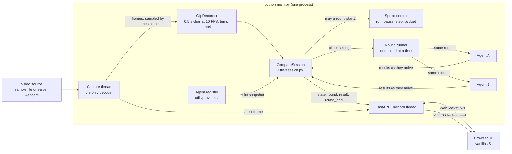
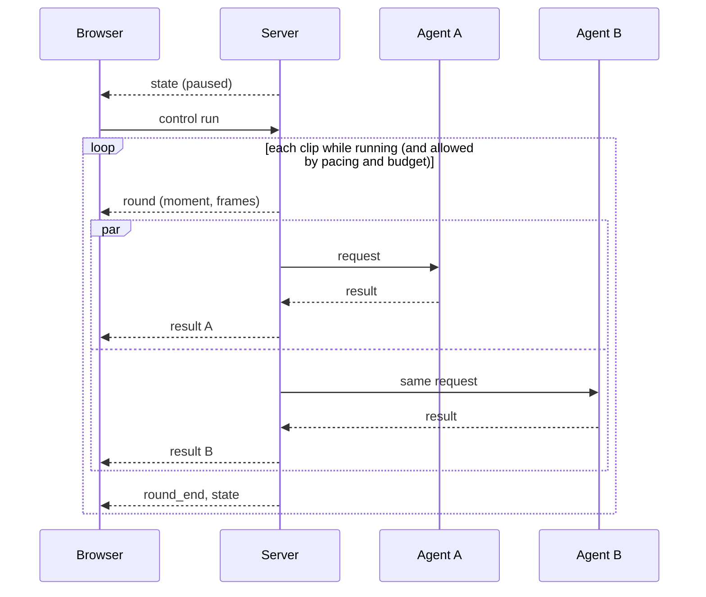

# Video Prompt Sandbox

**Compare two vision models on the same moments of a video, live in the browser: answers, latency, tokens and estimated cost side by side. Runs without a GPU; the local VideoLLaMA3-7B is optional.**

[](https://github.com/LordLokator/VLMPromptEngineeringSandbox/actions/workflows/ci.yml)
[](LICENSE)

## Bottom line

- **What it does:** cuts a video source into 0.5 s clips and asks **two agents** your prompt about the same frames of
  each clip, then shows both answers beside the video with latency, tokens and estimated cost. Change the prompt,
  temperature, resample FPS, agents or video while it runs; no restart.
- **Where it comes from:** a university demo for the Prompt Engineering course (VITMAV82), since **brought up to speed in an
  LLM-augmented overhaul**: audit, bug fixes, hardening, tests, CI and optional OpenTelemetry.
- **GPU testing:** the university version ran on **Ubuntu + RTX 4090** with `torch==2.2.0`, `transformers==4.46.3`
  and `numpy==1.24.4`. **Neither the current code nor the current ML pins have been run on a GPU.** The code is verified
  by lint, compile checks and tests with the model mocked. The new pins also had [CPU-only container
  checks](#ml-stack-what-was-checked), which do not show that the real model works.
- **What it is:** a small proof of concept for one user on localhost. It is not a production service.
- **Status:** the comparison works with the two built-in demo agents (no model). OpenAI, Anthropic, Ollama and
  OpenAI-compatible agents can be selected in the page, but **none has answered a real call yet**: they are tested
  with fake clients only. See [Roadmap](#roadmap-compare-two-models).


<sub>The previous single-agent UI, with placeholder replies. It will be replaced by a screenshot of the comparison view
from a real two-model run.</sub>

## Features

- **Two agents side by side:** agent A on the left, agent B on the right, the video in the middle. Both get the same
  frames of the same moment; the page shows those frames, the moment's time range and which round each answer is about.
- **Agents chosen in the page:** provider and model per side, with the provider's model list where it offers one (free
  text always works). Unavailable providers say why (for example a missing key).
- **Per answer:** latency, input and output tokens, estimated cost ("n/a" when unknown, "no API fee" for local agents),
  the model and the parameters sent; session totals per agent. "Faster" and "cheaper" are marked only when both
  answered the same round with known values; there is no quality verdict. A **Metrics** switch hides these figures.
- **Spend control:** analysis starts paused. Run, Pause and Step (one round). With a remote agent: at least 5 s between
  rounds and one budget of 50 rounds or $0.50 of priced calls, refilled only by "Reset budget"; auth errors, three
  failures in a row and the last page closing pause it. Also set a spending limit at the provider.
- **Runtime controls:** prompt, temperature (0.01 to 1.0) and resample FPS (slider 1 to 10) for the next round.
- **Sources:** either bundled street video (looping) or the **server's** webcam, picked from the page. Sending webcam
  frames to a remote provider asks for confirmation first.
- **One capture:** the browser preview and the model's clips come from the same decoder, and the video plays from app
  start, also while the model is still loading. The preview is scaled down to at most 720 px high; clips keep the
  source resolution.
- **Presets:** nine built-in street-scene prompts (dominant action, crossing, vehicle types, groups, unusual behaviour,
  activity level, sunlight, parking events, OCR); save your own from the UI.
- **Prompt history:** each prompt change is logged with a timestamp.
- **Failure behaviour:** an agent's error or timeout shows on its card and never affects the other agent; the browser
  reconnects with backoff (1 s to 10 s).
- **Demo agent:** with no model configured, a demo agent answers with facts measured on the frames it received (count,
  size, brightness, change between frames). It is not a model; it lets the app run anywhere. A second variant,
  `demo:frame-motion`, says when and where the picture changes most.
- **Optional OpenTelemetry** traces and metrics, off by default.

## Quick start

### Without a GPU (demo agent)

Needs Python 3.11 or 3.12 and `git`; no GPU, no torch, no API key.

```bash
git clone https://github.com/LordLokator/VLMPromptEngineeringSandbox VLMDemo
cd VLMDemo
python -m venv .venv
source .venv/bin/activate     # Windows: .venv\Scripts\activate
pip install .
python main.py
```

Open <http://localhost:8000/> and press **Run** (or **Step** for one round). The two demo agents answer each clip with
facts measured on its frames: one on size, brightness and change, the other on when and where the picture changes. They
run no model, so their answers ignore the prompt. Pick other agents in the cards, or start with `VLM_AGENT_A` /
`VLM_AGENT_B` (see [Configuration](#configuration)).

### With the local model (CUDA GPU)

Requirements (the tested OS is Ubuntu, with the university version):

- A CUDA GPU with FlashAttention2 support (Ampere or newer; see [Hardware](#hardware-and-performance)).
- An NVIDIA driver and toolkit (`nvcc`) for **CUDA 13**: the `torch==2.13.0` Linux wheel on PyPI is a CUDA 13 build,
  and flash-attn is compiled against it.
- `git`, and **Python 3.11**, the version the dependency checks ran on. CI also checks that the `gpu` extra resolves on
  3.12, but the model stack was not installed or run there.

```bash
git clone https://github.com/LordLokator/VLMPromptEngineeringSandbox VLMDemo
cd VLMDemo
bash setup.sh                 # creates .venv, installs the "gpu" extra and flash-attn
source .venv/bin/activate
VLM_AGENT_A=hf VLM_ENABLE_HF=1 python main.py
```

Without `VLM_AGENT_A=hf` and `VLM_ENABLE_HF=1` the app starts with the demo agent instead of the model.

**The flash-attn step has not been built for this repository.** `setup.sh` installs it from a pinned upstream commit,
because the latest PyPI release (2.8.3.post2, checked 2026-11-26) compiles as C++17 while torch 2.13 headers use C++20
syntax. The build can need a lot of memory: an [upstream report](https://github.com/Dao-AILab/flash-attention/issues/2995)
on 2.8.3.post1 saw more than 10 GB for a single compile process. flash-attn is the last thing the script installs, so
if only that step fails, activating `.venv` and running `VLM_ATTN_IMPL=sdpa python main.py` is worth trying (also not
run on a GPU).

Open <http://localhost:8000/>. The model repository is downloaded from Hugging Face at a pinned revision and loaded from
that local snapshot; no VideoLLaMA3 clone is needed. Inference starts once the model has loaded, with a placeholder
prompt until you send your own.

Every install uses the headless OpenCV build (`opencv-python-headless`); the `gpu` extra no longer adds
`opencv-python`. The model's remote code at the pinned revision calls only `cv2.imread` and `cv2.cvtColor`, which the
headless build has. That was checked by reading the code; **the headless build has not been imported together with
the remote code.**

## Architecture



Design choices:

- **One decoder per source.** A capture thread plays the selected source at its own speed. Clips sample it on a 10 FPS
  grid by frame timestamp (each point takes the latest frame at or before it), and never span two sources or the point
  where a file starts over. If timestamps stall or go backwards, the frame rate is used instead (30 FPS if the reported
  one is implausible). A file shorter than a clip holds its last frame. Writing clips happens on another thread.
- **A failed source stays failed** until a source is selected again: a file that yields no frames, a missing
  webcam, or one whose reads keep failing for 3 s. A camera read that never returns raises no error and delays a switch.
  After an error the preview shows an error image, and no clips are cut from it.
- **Each clip knows its moment:** source, source change counter, start and end time and loop number (webcam: wall-clock
  time). The `round` frame carries them with small thumbnails of the frames sent. A result for a clip from before the
  last source switch is still shown and counted (the call was made), marked "previous source", and does not replace
  the live answer. A clip whose source is already stale is not sent.
- **One round at a time, in lockstep, no queue.** Both agents run in parallel; the next round starts when both have
  answered, failed or timed out, so the slower agent sets the pace. Clips that arrive meanwhile are dropped, so answers
  do not fall behind the video. A call stuck in an SDK is abandoned after 130 s (each provider's own timeout is
  shorter) on a daemon thread; a late answer is not shown but still counts toward the budget.
- **Every agent has one contract** (`utils/providers/`): `generate(request) -> Result`. The request carries the clip's
  frames as JPEG with their times, the prompt and the settings of that round, and the clip file for the local model.
  The frames are the ones the local model's loader picks at the resample FPS, scaled to at most 768 px on the long edge
  at JPEG quality 80, and the same bytes go to every agent. The
  result carries the text, latency, tokens and cost where the provider reports them (`None` otherwise), and the
  parameters actually sent. Changing an agent applies from the next round.
- **All GPU code sits in `utils/vlm_wrapper.py`**, with lazy imports, so everything else is testable without torch.
- **Clips are temporary:** deleted once both agents are done, or immediately if dropped or skipped while paused.
- **Worker threads never touch sockets directly;** they hand messages to the server's event loop.

## Protocol

### WebSocket `/ws` (JSON text frames)

Every frame in both directions is a JSON object with a `type`.

**Client to server**

| `type` | Fields | Effect |
|---|---|---|
| `update` | `text`?: str, `temperature`?: number, `resample_fps`?: int | Settings for the next round (clamped to range); a non-empty `text` sets the prompt. |
| `control` | `action`: `run` \| `pause` \| `step` \| `reset_budget` | Spend control; a refusal comes back as `error`. |
| `set_agent` | `slot`: `A` \| `B`, `provider`, `model`?, `enabled`?: bool, `confirm`?: bool | Changes an agent from the next round. |
| `list_models` | `provider`, `refresh`?: bool | Replies with `models`. |
| `set_source` | `source_key`: `sample:1` \| `sample:2` \| `webcam`, `confirm`?: bool | Switches the source for all clients. |

Sending webcam frames to a remote agent needs `confirm: true`; without it the server answers with an `error` that has
`confirm: "webcam_remote"`, and the page asks.

**Server to client**

| `type` | Sent to | Content |
|---|---|---|
| `state` | the new client, then all clients on any change | Providers with availability and reason, both slots (provider, model, enabled, remote, where frames go), run state and budget, settings, current source and its error, selectable sources, price list date. |
| `round` | all | Round and clip ids, source, start and end time, loop, prompt, frame times and thumbnails (JPEG data URLs). |
| `result` | all | Round and clip ids, slot, `status` (`ok`, `error`, `timeout`, `skipped`), `stale`, text, `finish_reason`, `error{kind, message}`, metrics (latency, tokens, cost and its source, model, parameters sent). |
| `round_end` | all | Round id and each slot's status. |
| `models` | sender | A provider's model list, or the reason it failed. |
| `system`, `error` | sender (capture errors: all) | `text`. Errors name a kind of failure, the exception class and any HTTP status, never the exception message. |



Limits: `text` is capped at 2000 characters. A frame over 64 KiB closes the connection (code 1009). Browser connections from
another origin are rejected (code 1008). HTTP requests and WebSocket connections whose `Host` header is not in the
[allowlist](#configuration) are refused (HTTP 400).

### HTTP

| Route | Purpose |
|---|---|
| `GET /` | Web UI (static assets under `/src`) |
| `GET /favicon.ico` | Page icon |
| `GET /presets/<file>` | Static files from `presets/`, including saved user presets |
| `GET /video_feed` | MJPEG preview of the active source, at most 720 px high |
| `GET /preset_buttons` | Built-in and user presets, as a list of `{"label", "text"}` |
| `POST /save_preset` | JSON `{"label", "text"}`; the label is trimmed to 25 characters. Returns `{"status": "ok", "label"}`, or an error with status 400 or 415. |

FastAPI's `/docs` and `/redoc` are available only when bound to a loopback address.

## Configuration

All environment variables are optional. A git-ignored `.env` file in the repository root is read at startup (and by the
provider check below); a variable set in the real environment wins, even when it is empty. An empty variable counts as
unset.

Only these variables configure a provider. The OpenAI SDK would also read `OPENAI_ORG_ID`, `OPENAI_PROJECT_ID`,
`OPENAI_BASE_URL`, `OPENAI_CUSTOM_HEADERS` and others by itself; the app clears them, so nothing meant for OpenAI
reaches another server; likewise `ANTHROPIC_BASE_URL`, `ANTHROPIC_CUSTOM_HEADERS` and the Anthropic SDK's own
OpenTelemetry spans (`ANTHROPIC_OPEN_TELEMETRY*`) are not used. Provider clients do not follow redirects and do not
retry; each call times out after 30 s (120 s for Ollama, where a cold model load can take a while).

| Variable | Default | Meaning |
|---|---|---|
| `VLM_HOST` | `127.0.0.1` | Bind address. A non-loopback value requires `VLM_ALLOWED_HOSTS`, logs a warning (there is no authentication) and disables the API docs. |
| `VLM_ALLOWED_HOSTS` | empty | Comma-separated host names or IP addresses, without ports, that browsers use to reach the app, for example `192.168.1.20,mybox.local`. Added to `localhost`, `127.0.0.1` and `[::1]`, which are always allowed. `*.example.com` matches subdomains; a bare `*` is refused. Required when `VLM_HOST` is not loopback. It guards against DNS rebinding and is not authentication. |
| `VLM_PORT` | `8000` | Port. |
| `VLM_ATTN_IMPL` | `flash_attention_2` | Attention implementation passed to the model. No value has run on a GPU with the current pins; `sdpa` and `eager` ran only in the [CPU checks](#ml-stack-what-was-checked). |
| `VLM_AGENT_A`, `VLM_AGENT_B` | `demo`, `demo:frame-motion` | The agents at startup, as `provider` or `provider:model` (split at the first colon, so `ollama:llava:13b` works): `demo`, `openai`, `anthropic`, `ollama`, `compat` or `hf`. A missing key or URL stops the app at startup with a message. Both can be changed in the page. An empty value counts as unset. |
| `VLM_ENABLE_HF` | unset | `1` makes `hf` (local VideoLLaMA3) available, which downloads the model at a pinned revision and loads it at startup on a CUDA GPU. It can fill one slot at a time; if loading fails, that slot starts with its demo agent and the page says why. |
| `VLM_ALLOW_REMOTE_PAID` | unset | With a non-loopback `VLM_HOST`, remote (paid) agents are off unless this is `1`. |
| `VLM_BACKEND` | removed | Replaced by the two variables above; if set, the app stops at startup and names them. |
| `OPENAI_API_KEY` | unset | Key for `openai`. Sent only to `https://api.openai.com/v1`, never to another URL. |
| `ANTHROPIC_API_KEY` | unset | Key for `anthropic` (native Messages API). Sent only to `https://api.anthropic.com`. |
| `OLLAMA_BASE_URL` | `http://localhost:11434` | Ollama server for `ollama` (its OpenAI-compatible `/v1` API; models listed with `/api/tags` and `/api/show`). |
| `VLM_COMPAT_BASE_URL`, `VLM_COMPAT_API_KEY` | unset | Any OpenAI-compatible server for `compat` (OpenRouter, vLLM and others). Without a key the placeholder `EMPTY` is sent, never the OpenAI key. |
| `OTEL_ENABLED`, `OTEL_*` | off | See [Observability](#observability-opentelemetry). |

Files: user presets go to `presets/user_presets.json`, prompt history to `prompting/history.json`.

**Logs and errors:** logs go to stderr. Python's standard `logging` (uvicorn included), warnings and uncaught errors take
the same path. Tracebacks do not print local variable values. For agent and capture failures the log keeps the kind of
failure, the exception class, any HTTP status and the stack, not the exception message. Other errors, such as a model
that fails to load at startup, are logged with their message. The values of `OPENAI_API_KEY`,
`ANTHROPIC_API_KEY`, `VLM_COMPAT_API_KEY`, `HF_TOKEN` and `HUGGING_FACE_HUB_TOKEN`, if set and at least 8 characters
long, are replaced with `[redacted]` in log text. Output that bypasses Python logging, such as messages from native
libraries or the OpenTelemetry console exporter, is not filtered. An unhandled error inside a route is answered with a
plain HTTP 500 (WebSocket: close code 1011), so its text never reaches an OpenTelemetry span.

### Checking a provider

Each API adapter can be tried from the command line, one call, without the app:

```bash
python -m utils.providers.check openai --list                # the models the provider offers
python -m utils.providers.check openai <model>               # one call on one 0.5 s clip of the sample video
python -m utils.providers.check ollama <model> --fps 3       # 2 of the 5 frames, as the app would send them
```

Providers: `openai`, `anthropic`, `ollama`, `compat` (and `demo`). Anthropic gets no `temperature`: the API version
the pinned SDK sends (2026-10-21) has no sampling parameters in its Messages API. One call sends up to 5 frames (at
most 768 px on the long edge) and asks for at most 1024 output tokens; a paid provider charges for it. It prints the answer, finish reason, token
counts, latency, estimated cost and the parameters actually sent, never the key. If a model rejects `temperature`, the call is
repeated once without it, and that model is not sent one again during the run. **The adapters are unit-tested only:
none has answered a real call yet** (they were checked against a local stub server).

**Cost estimates** come from a price snapshot in [`utils/prices.json`](utils/prices.json): list prices of OpenAI and
Anthropic vision models, standard tier, taken on 2026-11-28 from [LiteLLM's price
map](https://github.com/BerriAI/litellm) (MIT licence, notice in the file). Only exact model ids match. An unknown
model, cache tokens without a rate, or input above a long-context limit give "n/a", never $0. Ollama on this machine
has no API fee; `compat` and remote or cloud Ollama models are unpriced, unless the server reports the cost itself
(as OpenRouter does in `usage.cost`), which then wins. The estimate is not a bill.

## Hardware and performance

Model: [`DAMO-NLP-SG/VideoLLaMA3-7B`](https://huggingface.co/DAMO-NLP-SG/VideoLLaMA3-7B) on HuggingFace Transformers,
bfloat16, FlashAttention2, on `cuda:0`. No quantization and no CPU fallback.

Measured by the author on Ubuntu + RTX 4090 (24 GB), with the university version and its pins (`torch==2.2.0`,
`transformers==4.46.3`, `numpy==1.24.4`). They were not re-measured on the current pins.

| Metric | Value |
|---|---|
| VRAM | about 24 GB required |
| Latency at 10 FPS resampling | about 200 ms |
| Latency at 30 to 40 FPS (similar setup; above this UI's 10 FPS limit) | about 400 ms |

## Limitations

- **Not run on a GPU** since the overhaul, which changed the model wrapper and the setup script, or since the ML pin
  upgrade or the switch to the `decord` video path. Loading the real weights and generating real answers are untested.
- **Localhost only:** there is no authentication, and settings and source are shared by all connected clients.
- **Answers lag the video:** an answer is about a half-second moment that has passed on screen by the time it arrives;
  the card says which moment.
- **API agents are unit-tested only:** no OpenAI, Anthropic, Ollama or compatible server has answered a real call from
  this code yet. Costs are estimates from a vendored list-price snapshot.
- **Capture is tested with fake and generated video only:** not with a real webcam, and not by watching the preview in a
  browser. The capture error message is sent once, so a page opened later shows only the error image.
- **No temporal memory:** each 0.5 s clip is answered on its own. Output arrives as a whole message, not token by token.
- **Resample FPS is coarse:** a 0.5 s clip has only 5 frames. Slider values 1 and 2 give the model 1 frame (shown as
  2 fps), 3 to 5 give 2 frames (4 fps), and 6 to 10 give all 5 (10 fps).
- **Accepted advisories:** `transformers==4.57.6`, the newest 4.x release, has known advisories. Six were reviewed on
  2026-11-27 and are ignored in [`osv-scanner.toml`](osv-scanner.toml) until 2027-02-28, each with its reason. The
  review read code and configuration; it did not try to exploit anything. The reasons depend on the pinned model
  revision and on loading it from a local snapshot. For GHSA-x9r9-c232-4q39, model loading does call the affected
  function, on a snapshot that has no `custom_generate/` directory.
- **Dependency scanning:** the osv-scanner CI job fails on any advisory that is not in that file. It scans a list
  resolved from the `gpu` extra in `pyproject.toml`, so transitive versions can differ between runs. It is not a
  required check. The dependency review job does not see the `gpu` extra. Dependabot alerts are based on the pins in
  `pyproject.toml` on the default branch.
- **Remote code:** the model loads with `trust_remote_code=True`. The app downloads one fixed repository revision and
  gives the loaders only that local directory. With `transformers==4.57.6`, passing the repository name and `revision=`
  was not enough: `AutoProcessor` looked up the files that choose which code to run on the `main` branch.

## ML stack: what was checked

The `gpu` extra pins `torch==2.13.0`, `transformers==4.57.6` and `numpy==2.4.6`, a coupled set because of the model's
remote code. The university version used `torch==2.2.0`, `transformers==4.46.3` and `numpy==1.24.4`.

Checked on 2026-11-26 in Linux Python 3.11 containers **without a GPU**, using CPU torch wheels, the model's code,
config and tokenizer files at the pinned revision, and **no model weights**:

- **Dependencies:** the set installs and passes `pip check`. The set with PyPI's CUDA wheels resolves (not installed)
  on Python 3.11 and 3.12.
- **Remote code:** its classes import, and the config and processor load. This needs a short alias in
  [`utils/vlm_wrapper.py`](utils/vlm_wrapper.py) for a name that transformers moved.
- **Video input:** for three clips written by the app's recorder, at each FPS from 1 to 10, the old and new pins gave
  identical processor output on the loader path the app used then, which ran system `ffmpeg` and failed at 1 FPS.
- **Architecture:** built on the `meta` device with `sdpa` and `eager`, the model's 779 tensor names match the
  checkpoint index, and so does its total size at `bfloat16`.
- **Load and generate:** with a **tiny, randomly initialised** copy of the architecture saved locally, the app's own
  `VLM` class loaded it and generated tokens with `sdpa` and `eager`. The output is meaningless by design.

The app now selects the loader's `decord` path. Checked on 2026-11-27 in the same kind of container, **without a GPU
and without `ffmpeg` or `ffprobe` installed**:

- The real processor ran for three recorder clips at each FPS from 1 to 10. Its frame counts matched the rate the app
  reports, and it started no subprocess.
- The tiny-model load and generate check passed again with `sdpa` and `eager`, at 10, 2 and 5 FPS.
- At 10 FPS, both loader paths returned identical frames for those three clips (compared with `ffmpeg` installed).

Not checked: anything on a GPU (CUDA wheels, `device_map` to a GPU, the flash-attn build and `flash_attention_2`),
loading the real weights, answer quality, VRAM and latency.

## Observability (OpenTelemetry)

Off by default; nothing from `opentelemetry` is imported unless enabled.

```bash
pip install ".[otel]"

# spans and metrics printed to the console
OTEL_ENABLED=1 python main.py

# send to an OTLP/gRPC collector
OTEL_ENABLED=1 OTEL_TRACES_EXPORTER=otlp OTEL_METRICS_EXPORTER=otlp \
  OTEL_EXPORTER_OTLP_ENDPOINT=http://localhost:4317 python main.py
```

| Signal | Name | Notes |
|---|---|---|
| Span | `vlm.inference` | One per processed clip: agent (`provider:model`), FPS, max frames, temperature; on failure, error status and exception type (no message or stack trace). |
| Histogram | `vlm.inference.duration` | Seconds, by agent and outcome. |
| Counter | `vlm.inference.errors` | By agent. |
| Counter | `vlm.clips.dropped` | Clips skipped while a round was running. |
| Counter | `ws.messages` | Client messages, by `type` (unknown ones as `other`). |
| Up/down counter | `ws.connections` | Active WebSocket connections. |
| FastAPI instrumentation | HTTP spans and metrics | `/video_feed` and per-message WebSocket spans are excluded. |

The app's own spans and metrics never include prompt text, model output, clip paths or frames. `OTEL_SERVICE_NAME` and
`OTEL_METRIC_EXPORT_INTERVAL` are honoured. Besides the in-memory exporter tests, every signal in the table was checked
once against `grafana/otel-lgtm:0.41.1` on 2026-11-26 with a mocked backend, over OTLP/gRPC.

## Roadmap: compare two models

The goal for the first release: pick two models, play a video, and compare what they say about the same moment, and what
it costs. **Done and tested with the demo agents and fake API clients**, not yet with a real provider:

| Planned | Status |
|---|---|
| Run without a GPU | Done: `pip install .` starts with two built-in demo agents (no model); the local VideoLLaMA3 is optional. |
| Your own models | OpenAI, Anthropic, Ollama or any OpenAI-compatible URL, keys and URLs from environment variables. Selectable in the page; **not run against a real provider yet**. |
| Model selection | Done: provider and model per agent in the page, while the app runs. |
| Side-by-side view | Done: video in the middle, one agent on each side, the frames both received above the prompt. |
| Metrics | Done: latency, tokens and estimated cost per answer and per session, in blocks you can hide. |
| Cost control | Done: starts paused; run, pause, single step, pacing and limits on rounds and estimated spend. |
| Your own video | Planned: local `.mp4` / `.webm` files besides the samples and the server webcam. |

Design choices behind the plan:

- **Thin adapters on the official OpenAI and Anthropic SDKs instead of LiteLLM.** The app needs only a small part of what
  a router offers, and two SDKs add far fewer dependencies.
- **Frames, not video files,** go to remote models: it is the input form these APIs have in common.
- **Remote models are opt-in.** Using one sends frames of your video to that provider and may cost money.

## Tools

| Area | Used |
|---|---|
| Model | VideoLLaMA3-7B, HuggingFace Transformers, PyTorch, FlashAttention2 |
| Backend | Python, FastAPI, uvicorn (HTTP and WebSocket), Loguru |
| Video | OpenCV for capture and encoding; decord decodes clips for the model |
| Frontend | Vanilla JavaScript, Bootstrap CSS (vendored, so no CDN) |
| Observability | OpenTelemetry SDK, OTLP exporter, FastAPI instrumentation (optional) |
| Quality | pytest, Ruff, GitHub Actions, gitleaks, osv-scanner, dependency review, Dependabot |

## Development

No GPU needed: the model is mocked in tests, and agents are faked (`tests/fake_agents.py`). One test starts the real
`python main.py` with the demo agent on a free loopback port and waits for an answer over `/ws`. Tests under
`tests/manual/` need a real device or file and are skipped unless `VLM_MANUAL_TESTS=1`; their docstring says what they
use.

```bash
pip install ".[dev]"
python -m compileall -q .
ruff check .
pytest -q
```

CI runs lint and a compile check, tests on Python 3.11 and 3.12, a plain `pip install .` in a new venv that imports the
app with torch blocked, and a dependency-resolution check of the `gpu` and `dev` extras on both versions (each must
resolve to exactly one OpenCV distribution).

All dependencies are declared in [`pyproject.toml`](pyproject.toml), whose comments describe each group and how to install
it; no requirements or lock file is committed. The security workflow's osv-scanner job resolves the `gpu` extra (and the
base dependencies) for Linux and Python 3.11 into a temporary file and scans it (see [Limitations](#limitations)).
Unpinned and transitive versions are whatever resolves on that run; they are not the university version's environment.

```
main.py, web_engine.py   wiring and shutdown; HTTP and /ws
utils/                   agents (providers/), rounds and spend control, VLM wrapper, telemetry, presets, file helpers
video_handling/          capture, clip recording, streaming
prompting/               prompt state, runtime settings, history
src/                     frontend
presets/, static_video/  built-in prompts, sample videos
tests/                   GPU-free test suite
```

## Background

Built for the university course Prompt Engineering (VITMAV82). The goal was not another LLM chat interface, but a
controlled sandbox to:

- explore prompt design for multimodal models,
- experiment with temporal video chunking,
- observe latency vs. FPS trade-offs,
- study how a Video-LLM behaves.

The original version was built in May 2025. The November 2026 overhaul was done using Claude Code.

The overhaul kept the scope small and made the demo hold up better. Among other things, it fixed a temperature
slider that had no effect, added the resample FPS control, changed the default bind address to localhost, added input
validation and clean shutdown, and introduced the test suite, CI, the backend seam and OpenTelemetry.

## License

MIT, see [LICENSE](LICENSE). The vendored Bootstrap CSS has its [own license file](src/vendor/bootstrap.LICENSE). The model
is downloaded separately and is subject to its own terms.
