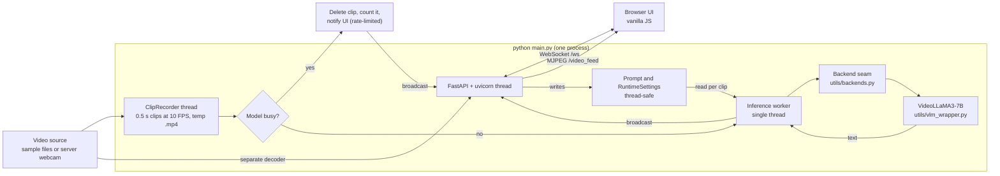
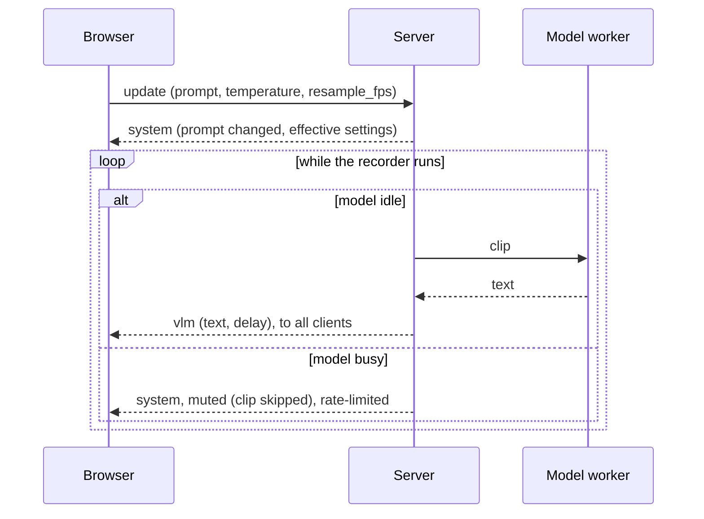

# Video Prompt Sandbox

**Live prompt editing against a Video-LLM (VideoLLaMA3-7B) on short video clips, in the browser.**

[](https://github.com/LordLokator/VLMPromptEngineeringSandbox/actions/workflows/ci.yml)
[](LICENSE)

## Bottom line

- **What it does:** cuts a video source into 0.5 s clips, asks the model your current prompt about them, and shows the answers
  next to the video. Change the prompt, temperature or resample FPS while it runs; no restart.
- **Where it comes from:** a university demo for the Prompt Engineering course (VITMAV82), since **brought up to speed in an
  LLM-augmented overhaul**: audit, bug fixes, hardening, tests, CI and optional OpenTelemetry.
- **GPU testing:** the university version ran on **Ubuntu + RTX 4090**. **The current code has not been run on a GPU.**
  Since the overhaul it is verified by lint, compile checks and tests with the model mocked.
- **What it is:** a small proof of concept for one user on localhost. It is not a production service.
- **Where it is heading:** a generic, model-agnostic app, using **OpenTelemetry** for observability (basic version in place)
  and **LiteLLM** for model routing (not implemented yet). See [Direction](#direction-a-generic-app).


<sub>UI layout. The model replies in this screenshot are placeholder text, and it predates the resample FPS slider.</sub>

## Features

- **Live prompt iteration:** the next clip that goes to the model uses the new prompt.
- **Runtime controls:** temperature (0.01 to 1.0) and resample FPS (slider 1 to 10). The model processor strides over whole
  frames, so the effective rates are 1, 2, 3.33, 5 and 10 FPS; the UI reports the one in use.
- **Two sources:** the bundled street videos (default) or a webcam, switched from the UI. The webcam is the one attached to
  the **server** machine, not the browser's.
- **Presets:** nine built-in street-scene prompts (dominant action, crossing, vehicle types, groups, unusual behaviour,
  activity level, sunlight, parking events, OCR); save your own from the UI.
- **Prompt history:** each prompt change is logged with a timestamp.
- **Failure behaviour:** inference errors appear in the chat, the browser reconnects with backoff (1 s to 10 s), and clips
  skipped while the model is busy are reported (at most one notice per 5 s).
- **Optional OpenTelemetry** traces and metrics, off by default.

## Quick start

Requires a CUDA GPU with FlashAttention2 support (Ampere or newer; see [Hardware](#hardware-and-performance)) and
Python 3.11 (inferred from the `numpy==1.24.4` pin, which has no wheels for 3.12 or newer). `setup.sh` is a Bash script,
and the tested OS is Ubuntu.

```bash
git clone https://github.com/LordLokator/VLMPromptEngineeringSandbox VLMDemo
cd VLMDemo
bash setup.sh                 # creates .venv, installs the "gpu" extra and flash-attn
source .venv/bin/activate
python main.py
```

Open <http://localhost:8000/>. The model is downloaded from Hugging Face at a pinned revision; no VideoLLaMA3 clone is needed.
Inference starts once the model has loaded, with a placeholder prompt until you send your own.

No GPU? You cannot run the app, but you can run the [tests](#development).

## Architecture



Design choices:

- **One inference at a time, no queue.** Clips that arrive while the model is busy are dropped, so answers do not fall
  further and further behind the video.
- **A backend is one method:** `forward(video_path, fps, max_frames, temperature) -> (text, temperature)`.
- **All GPU code sits in `utils/vlm_wrapper.py`**, with lazy imports, so everything else is testable without torch.
- **Clips are temporary:** deleted after inference, or immediately if dropped.
- **Worker threads never touch sockets directly;** they hand messages to the server's event loop.

## Protocol

### WebSocket `/ws` (JSON text frames)

**Client to server**

| Message | Shape | Effect |
|---|---|---|
| Update | `{"role": "user", "text": str, "temperature"?: number, "resample_fps"?: int}` | Applies the settings (clamped to range) and, if `text` is not empty, sets the prompt. |
| Toggle source | `{"role": "user", "text": "toggle_stream"}` | Switches between sample video and webcam, **for all clients**. `toggle_stream` is therefore a reserved prompt. |

**Server to client:** one envelope, `{"type": ..., "text": str}`

| `type` | Extra fields | Sent to | When |
|---|---|---|---|
| `vlm` | `delay`: seconds spent processing the clip | all clients | A model answer. |
| `system` | none | sender | Acknowledges an update or a source toggle. |
| `system` | `muted: true` | all clients | A clip was skipped because the model was busy. |
| `error` | none | sender | A frame or setting was rejected. |
| `error` | none | all clients | Inference or the capture source failed. |



Limits: `text` is capped at 2000 characters. A frame over 64 KiB closes the connection (code 1009). Browser connections from
another origin are rejected (code 1008).

### HTTP

| Route | Purpose |
|---|---|
| `GET /` | Web UI (static assets under `/src`) |
| `GET /video_feed` | MJPEG stream of the active source |
| `GET /preset_buttons` | Built-in and user presets, as a list of `{"label", "text"}` |
| `POST /save_preset` | JSON `{"label", "text"}`; the label is trimmed to 25 characters. Returns `{"status": "ok", "label"}`, or an error with status 400 or 415. |

FastAPI's `/docs` and `/redoc` are available only when bound to a loopback address.

## Configuration

All environment variables are optional.

| Variable | Default | Meaning |
|---|---|---|
| `VLM_HOST` | `127.0.0.1` | Bind address. A non-loopback value logs a warning (there is no authentication) and disables the API docs. |
| `VLM_PORT` | `8000` | Port. |
| `VLM_ATTN_IMPL` | `flash_attention_2` | Attention implementation passed to the model. Other values are untested. |
| `VLM_BACKEND` | `hf` | Inference backend. Only `hf` (local VideoLLaMA3) exists; any other value fails at startup. |
| `OTEL_ENABLED`, `OTEL_*` | off | See [Observability](#observability-opentelemetry). |

Files: user presets go to `presets/user_presets.json`, prompt history to `prompting/history.json`.

## Hardware and performance

Model: [`DAMO-NLP-SG/VideoLLaMA3-7B`](https://huggingface.co/DAMO-NLP-SG/VideoLLaMA3-7B) on HuggingFace Transformers,
bfloat16, FlashAttention2, on `cuda:0`. No quantization and no CPU fallback.

Measured by the author on Ubuntu + RTX 4090 (24 GB), with the university version:

| Metric | Value |
|---|---|
| VRAM | about 24 GB required |
| Latency at 10 FPS resampling | about 200 ms |
| Latency at 30 to 40 FPS (similar setup; above this UI's 10 FPS limit) | about 400 ms |

## Limitations

- **Not re-tested on a GPU** since the overhaul, which also changed the model wrapper and the setup script.
- **Localhost only:** there is no authentication, and settings and source are shared by all connected clients.
- **Video and answers are not synchronised:** the browser stream and the model's clips come from separate decoders.
- **No temporal memory:** each 0.5 s clip is answered on its own. Output arrives as a whole message, not token by token.
- **Old ML stack:** the `gpu` extra pins `torch==2.2.0`, `transformers==4.46.3` and `numpy==1.24.4`, a coupled set required
  by the model's remote code. These versions have known security advisories. An upgrade is planned and will not wait for
  a GPU test.
- **ML dependency scanning is not working yet:** the dependency scan (osv-scanner, non-blocking) finds no package files.
  GitHub's dependency graph listed the `torch`, `transformers` and `numpy` pins when checked on 2026-11-26 (no
  transitive packages), but no Dependabot alert had appeared a few minutes later. Do not read an empty alert list as
  a sign that these pins are safe.
- **Remote code:** the model loads with `trust_remote_code=True`, pinned to a fixed repository revision.

## Observability (OpenTelemetry)

Off by default; nothing from `opentelemetry` is imported unless enabled.

```bash
pip install ".[otel]"

# spans and metrics printed to the console
OTEL_ENABLED=1 python main.py

# send to an OTLP/gRPC collector
OTEL_ENABLED=1 OTEL_TRACES_EXPORTER=otlp OTEL_METRICS_EXPORTER=otlp \
  OTEL_EXPORTER_OTLP_ENDPOINT=http://localhost:4317 python main.py
```

| Signal | Name | Notes |
|---|---|---|
| Span | `vlm.inference` | One per processed clip: backend, FPS, max frames, temperature; on failure, error status and exception type (no message or stack trace). |
| Histogram | `vlm.inference.duration` | Seconds, by backend and outcome. |
| Counter | `vlm.inference.errors` | By backend. |
| Counter | `vlm.clips.dropped` | Clips skipped while inference was busy. |
| Counter | `ws.messages` | Parsed client messages, by role. |
| Up/down counter | `ws.connections` | Active WebSocket connections. |
| FastAPI instrumentation | HTTP spans and metrics | `/video_feed` and per-message WebSocket spans are excluded. |

The app's own spans and metrics never include prompt text, model output, clip paths or frames. `OTEL_SERVICE_NAME` and
`OTEL_METRIC_EXPORT_INTERVAL` are honoured. Besides the in-memory exporter tests, every signal in the table was checked
once against `grafana/otel-lgtm:0.41.1` on 2026-11-26 with a mocked backend, over OTLP/gRPC.

## Direction: a generic app

The aim is to turn a single-model demo into a generic app: the same UI and prompt workflow against any capable model, local
or remote, with comparable latency and error data for each.

| Piece | Role | Status |
|---|---|---|
| Backend seam (`VLM_BACKEND`) | One interface for any model | In place; only `hf` is selectable. A `ChainBackend` failover class exists and is tested, but is not selectable yet. |
| OpenTelemetry | Vendor-neutral traces and metrics, labelled by backend | App-level instrumentation in place; checked against a local collector with a mocked backend. |
| LiteLLM | Routing and failover across providers and self-hosted servers | **Planned, not implemented.** |

Known hurdles for LiteLLM:

- Current LiteLLM releases cannot be installed next to the pinned `transformers==4.46.3` (conflicting `tokenizers`
  requirements, checked 2026-11-25). It needs an ML stack upgrade, a separate environment, or an older release. If none
  works well, a plain OpenAI-compatible client behind the same seam is the fallback.
- Video support differs between providers and servers. Image-only models would need clips sent as sampled frames.
- A remote backend sends your video off the machine, so it will be opt-in.

## Tools

| Area | Used |
|---|---|
| Model | VideoLLaMA3-7B, HuggingFace Transformers, PyTorch, FlashAttention2 |
| Backend | Python, FastAPI, uvicorn (HTTP and WebSocket), Loguru |
| Video | OpenCV for capture and encoding, decord in the model's video loading stack |
| Frontend | Vanilla JavaScript, Bootstrap CSS (vendored, so no CDN) |
| Observability | OpenTelemetry SDK, OTLP exporter, FastAPI instrumentation (optional) |
| Quality | pytest, Ruff, GitHub Actions, gitleaks, osv-scanner, dependency review, Dependabot |

## Development

No GPU needed: the model is mocked in tests.

```bash
pip install ".[dev]"
python -m compileall -q .
ruff check .
pytest -q
```

CI runs lint and a compile check, tests on Python 3.11 and 3.12, and a dependency-resolution check of the `gpu` extra.
Vulnerability scanning of that extra is not working yet (see [Limitations](#limitations)).

```
main.py, web_engine.py   wiring and shutdown; HTTP and /ws
utils/                   backend selection, VLM wrapper, telemetry, presets, file helpers
video_handling/          capture, clip recording, streaming
prompting/               prompt state, runtime settings, history
src/                     frontend
presets/, static_video/  built-in prompts, sample videos
tests/                   GPU-free test suite
```

## Background

Built for the university course Prompt Engineering (VITMAV82). The goal was not another LLM chat interface, but a
controlled sandbox to:

- explore prompt design for multimodal models,
- experiment with temporal video chunking,
- observe latency vs. FPS trade-offs,
- study how a Video-LLM behaves.

The original version was built in May 2025. The November 2026 overhaul was done using Claude Code.

The overhaul kept the scope small and made the demo hold up better. Among other things, it fixed a temperature
slider that had no effect, added the resample FPS control, changed the default bind address to localhost, added input
validation and clean shutdown, and introduced the test suite, CI, the backend seam and OpenTelemetry.

## License

MIT, see [LICENSE](LICENSE). The vendored Bootstrap CSS has its [own license file](src/vendor/bootstrap.LICENSE). The model
is downloaded separately and is subject to its own terms.
