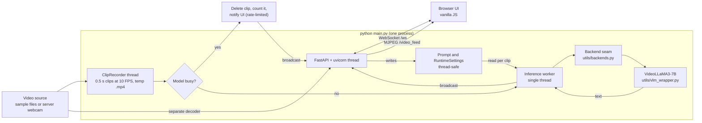
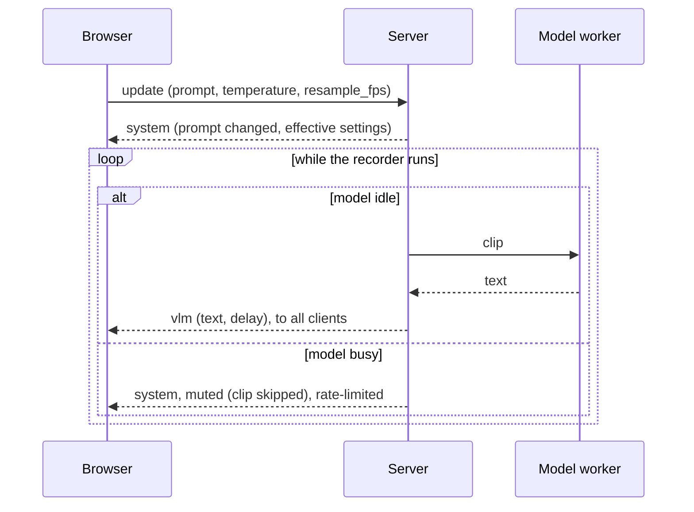

# Video Prompt Sandbox

**Live prompt editing against a Video-LLM (VideoLLaMA3-7B) on short video clips, in the browser.**

[](https://github.com/LordLokator/VLMPromptEngineeringSandbox/actions/workflows/ci.yml)
[](LICENSE)

## Bottom line

- **What it does:** cuts a video source into 0.5 s clips, asks the model your current prompt about them, and shows the answers
  next to the video. Change the prompt, temperature or resample FPS while it runs; no restart.
- **Where it comes from:** a university demo for the Prompt Engineering course (VITMAV82), since **brought up to speed in an
  LLM-augmented overhaul**: audit, bug fixes, hardening, tests, CI and optional OpenTelemetry.
- **GPU testing:** the university version ran on **Ubuntu + RTX 4090** with `torch==2.2.0`, `transformers==4.46.3`
  and `numpy==1.24.4`. **Neither the current code nor the current ML pins have been run on a GPU.** The code is verified
  by lint, compile checks and tests with the model mocked. The new pins also had [CPU-only container
  checks](#ml-stack-what-was-checked), which do not show that the real model works.
- **What it is:** a small proof of concept for one user on localhost. It is not a production service.
- **Where it is heading:** a generic, model-agnostic app, using **OpenTelemetry** for observability (basic version in place)
  and **LiteLLM** for model routing (not implemented yet). See [Direction](#direction-a-generic-app).


<sub>UI layout. The model replies in this screenshot are placeholder text, and it predates the resample FPS slider.</sub>

## Features

- **Live prompt iteration:** the next clip that goes to the model uses the new prompt.
- **Runtime controls:** temperature (0.01 to 1.0) and resample FPS (slider 1 to 10). The reply shows the effective
  rate; a 5-frame clip allows only a few: see [Limitations](#limitations).
- **Two sources:** the bundled street videos (default) or a webcam, switched from the UI. The webcam is the one attached to
  the **server** machine, not the browser's.
- **Presets:** nine built-in street-scene prompts (dominant action, crossing, vehicle types, groups, unusual behaviour,
  activity level, sunlight, parking events, OCR); save your own from the UI.
- **Prompt history:** each prompt change is logged with a timestamp.
- **Failure behaviour:** inference errors appear in the chat, the browser reconnects with backoff (1 s to 10 s), and clips
  skipped while the model is busy are reported (at most one notice per 5 s).
- **Optional OpenTelemetry** traces and metrics, off by default.

## Quick start

Requirements (the tested OS is Ubuntu, with the university version):

- A CUDA GPU with FlashAttention2 support (Ampere or newer; see [Hardware](#hardware-and-performance)).
- An NVIDIA driver and toolkit (`nvcc`) for **CUDA 13**: the `torch==2.13.0` Linux wheel on PyPI is a CUDA 13 build,
  and flash-attn is compiled against it.
- `git`, and **Python 3.11**, the version the dependency checks ran on. CI also checks that the `gpu` extra resolves on
  3.12, but the model stack was not installed or run there.

```bash
git clone https://github.com/LordLokator/VLMPromptEngineeringSandbox VLMDemo
cd VLMDemo
bash setup.sh                 # creates .venv, installs the "gpu" extra and flash-attn
source .venv/bin/activate
python main.py
```

**The flash-attn step has not been built for this repository.** `setup.sh` installs it from a pinned upstream commit,
because the latest PyPI release (2.8.3.post2, checked 2026-11-26) compiles as C++17 while torch 2.13 headers use C++20
syntax. The build can need a lot of memory: an [upstream report](https://github.com/Dao-AILab/flash-attention/issues/2995)
on 2.8.3.post1 saw more than 10 GB for a single compile process. flash-attn is the last thing the script installs, so
if only that step fails, `VLM_ATTN_IMPL=sdpa python main.py` is worth trying (also not run on a GPU).

Open <http://localhost:8000/>. The model repository is downloaded from Hugging Face at a pinned revision and loaded from
that local snapshot; no VideoLLaMA3 clone is needed. Inference starts once the model has loaded, with a placeholder
prompt until you send your own.

No GPU? You cannot run the app, but you can run the [tests](#development).

## Architecture



Design choices:

- **One inference at a time, no queue.** Clips that arrive while the model is busy are dropped, so answers do not fall
  further and further behind the video.
- **A backend is one method:** `forward(video_path, fps, max_frames, temperature) -> (text, temperature)`.
- **All GPU code sits in `utils/vlm_wrapper.py`**, with lazy imports, so everything else is testable without torch.
- **Clips are temporary:** deleted after inference, or immediately if dropped.
- **Worker threads never touch sockets directly;** they hand messages to the server's event loop.

## Protocol

### WebSocket `/ws` (JSON text frames)

**Client to server**

| Message | Shape | Effect |
|---|---|---|
| Update | `{"role": "user", "text": str, "temperature"?: number, "resample_fps"?: int}` | Applies the settings (clamped to range) and, if `text` is not empty, sets the prompt. |
| Toggle source | `{"role": "user", "text": "toggle_stream"}` | Switches between sample video and webcam, **for all clients**. `toggle_stream` is therefore a reserved prompt. |

**Server to client:** one envelope, `{"type": ..., "text": str}`

| `type` | Extra fields | Sent to | When |
|---|---|---|---|
| `vlm` | `delay`: seconds spent processing the clip | all clients | A model answer. |
| `system` | none | sender | Acknowledges an update or a source toggle. |
| `system` | `muted: true` | all clients | A clip was skipped because the model was busy. |
| `error` | none | sender | A frame or setting was rejected. |
| `error` | none | all clients | Inference or the capture source failed. |



Limits: `text` is capped at 2000 characters. A frame over 64 KiB closes the connection (code 1009). Browser connections from
another origin are rejected (code 1008).

### HTTP

| Route | Purpose |
|---|---|
| `GET /` | Web UI (static assets under `/src`) |
| `GET /video_feed` | MJPEG stream of the active source |
| `GET /preset_buttons` | Built-in and user presets, as a list of `{"label", "text"}` |
| `POST /save_preset` | JSON `{"label", "text"}`; the label is trimmed to 25 characters. Returns `{"status": "ok", "label"}`, or an error with status 400 or 415. |

FastAPI's `/docs` and `/redoc` are available only when bound to a loopback address.

## Configuration

All environment variables are optional.

| Variable | Default | Meaning |
|---|---|---|
| `VLM_HOST` | `127.0.0.1` | Bind address. A non-loopback value logs a warning (there is no authentication) and disables the API docs. |
| `VLM_PORT` | `8000` | Port. |
| `VLM_ATTN_IMPL` | `flash_attention_2` | Attention implementation passed to the model. No value has run on a GPU with the current pins; `sdpa` and `eager` ran only in the [CPU checks](#ml-stack-what-was-checked). |
| `VLM_BACKEND` | `hf` | Inference backend. Only `hf` (local VideoLLaMA3) exists; any other value fails at startup. |
| `OTEL_ENABLED`, `OTEL_*` | off | See [Observability](#observability-opentelemetry). |

Files: user presets go to `presets/user_presets.json`, prompt history to `prompting/history.json`.

## Hardware and performance

Model: [`DAMO-NLP-SG/VideoLLaMA3-7B`](https://huggingface.co/DAMO-NLP-SG/VideoLLaMA3-7B) on HuggingFace Transformers,
bfloat16, FlashAttention2, on `cuda:0`. No quantization and no CPU fallback.

Measured by the author on Ubuntu + RTX 4090 (24 GB), with the university version and its pins (`torch==2.2.0`,
`transformers==4.46.3`, `numpy==1.24.4`). They were not re-measured on the current pins.

| Metric | Value |
|---|---|
| VRAM | about 24 GB required |
| Latency at 10 FPS resampling | about 200 ms |
| Latency at 30 to 40 FPS (similar setup; above this UI's 10 FPS limit) | about 400 ms |

## Limitations

- **Not run on a GPU** since the overhaul, which changed the model wrapper and the setup script, or since the ML pin
  upgrade. Loading the real weights and generating real answers are untested.
- **Localhost only:** there is no authentication, and settings and source are shared by all connected clients.
- **Video and answers are not synchronised:** the browser stream and the model's clips come from separate decoders.
- **No temporal memory:** each 0.5 s clip is answered on its own. Output arrives as a whole message, not token by token.
- **Resample FPS is coarse:** a 0.5 s clip has only 5 frames. Slider values 1 and 2 give the model 1 frame (shown as
  2 fps), 3 to 5 give 2 frames (4 fps), and 6 to 10 give all 5 (10 fps).
- **Accepted advisories:** `transformers==4.57.6`, the newest 4.x release, has known advisories. Six were reviewed on
  2026-11-27 and are ignored in [`osv-scanner.toml`](osv-scanner.toml) until 2027-02-28, each with its reason. The
  review read code and configuration; it did not try to exploit anything. The reasons depend on the pinned model
  revision and on loading it from a local snapshot. For GHSA-x9r9-c232-4q39, model loading does call the affected
  function, on a snapshot that has no `custom_generate/` directory.
- **Dependency scanning:** the osv-scanner CI job fails on any advisory that is not in that file. It scans a list
  resolved from the `gpu` extra in `pyproject.toml`, so transitive versions can differ between runs. It is not a
  required check. The dependency review job does not see the `gpu` extra. Dependabot alerts are based on the pins in
  `pyproject.toml` on the default branch.
- **Remote code:** the model loads with `trust_remote_code=True`. The app downloads one fixed repository revision and
  gives the loaders only that local directory. With `transformers==4.57.6`, passing the repository name and `revision=`
  was not enough: `AutoProcessor` looked up the files that choose which code to run on the `main` branch.

## ML stack: what was checked

The `gpu` extra pins `torch==2.13.0`, `transformers==4.57.6` and `numpy==2.4.6`, a coupled set because of the model's
remote code. The university version used `torch==2.2.0`, `transformers==4.46.3` and `numpy==1.24.4`.

Checked on 2026-11-26 in Linux Python 3.11 containers **without a GPU**, using CPU torch wheels, the model's code,
config and tokenizer files at the pinned revision, and **no model weights**:

- **Dependencies:** the set installs and passes `pip check`. The set with PyPI's CUDA wheels resolves (not installed)
  on Python 3.11 and 3.12.
- **Remote code:** its classes import, and the config and processor load. This needs a short alias in
  [`utils/vlm_wrapper.py`](utils/vlm_wrapper.py) for a name that transformers moved.
- **Video input:** for three clips written by the app's recorder, at each FPS from 1 to 10, the old and new pins gave
  identical processor output on the loader path the app used then, which ran system `ffmpeg` and failed at 1 FPS.
- **Architecture:** built on the `meta` device with `sdpa` and `eager`, the model's 779 tensor names match the
  checkpoint index, and so does its total size at `bfloat16`.
- **Load and generate:** with a **tiny, randomly initialised** copy of the architecture saved locally, the app's own
  `VLM` class loaded it and generated tokens with `sdpa` and `eager`. The output is meaningless by design.

The app now selects the loader's `decord` path. Checked on 2026-11-27 in the same kind of container, **without a GPU
and without `ffmpeg` or `ffprobe` installed**:

- The real processor ran for three recorder clips at each FPS from 1 to 10. Its frame counts matched the rate the app
  reports, and it started no subprocess.
- The tiny-model load and generate check passed again with `sdpa` and `eager`, at 10, 2 and 5 FPS.
- At 10 FPS, both loader paths returned identical frames for those three clips (compared with `ffmpeg` installed).

Not checked: anything on a GPU (CUDA wheels, `device_map` to a GPU, the flash-attn build and `flash_attention_2`),
loading the real weights, answer quality, VRAM and latency.

## Observability (OpenTelemetry)

Off by default; nothing from `opentelemetry` is imported unless enabled.

```bash
pip install ".[otel]"

# spans and metrics printed to the console
OTEL_ENABLED=1 python main.py

# send to an OTLP/gRPC collector
OTEL_ENABLED=1 OTEL_TRACES_EXPORTER=otlp OTEL_METRICS_EXPORTER=otlp \
  OTEL_EXPORTER_OTLP_ENDPOINT=http://localhost:4317 python main.py
```

| Signal | Name | Notes |
|---|---|---|
| Span | `vlm.inference` | One per processed clip: backend, FPS, max frames, temperature; on failure, error status and exception type (no message or stack trace). |
| Histogram | `vlm.inference.duration` | Seconds, by backend and outcome. |
| Counter | `vlm.inference.errors` | By backend. |
| Counter | `vlm.clips.dropped` | Clips skipped while inference was busy. |
| Counter | `ws.messages` | Parsed client messages, by role. |
| Up/down counter | `ws.connections` | Active WebSocket connections. |
| FastAPI instrumentation | HTTP spans and metrics | `/video_feed` and per-message WebSocket spans are excluded. |

The app's own spans and metrics never include prompt text, model output, clip paths or frames. `OTEL_SERVICE_NAME` and
`OTEL_METRIC_EXPORT_INTERVAL` are honoured. Besides the in-memory exporter tests, every signal in the table was checked
once against `grafana/otel-lgtm:0.41.1` on 2026-11-26 with a mocked backend, over OTLP/gRPC.

## Direction: a generic app

The aim is to turn a single-model demo into a generic app: the same UI and prompt workflow against any capable model, local
or remote, with comparable latency and error data for each.

| Piece | Role | Status |
|---|---|---|
| Backend seam (`VLM_BACKEND`) | One interface for any model | In place; only `hf` is selectable. A `ChainBackend` failover class exists and is tested, but is not selectable yet. |
| OpenTelemetry | Vendor-neutral traces and metrics, labelled by backend | App-level instrumentation in place; checked against a local collector with a mocked backend. |
| LiteLLM | Routing and failover across providers and self-hosted servers | **Planned, not implemented.** |

Known hurdles for LiteLLM:

- On 2026-11-25, current LiteLLM releases could not be installed next to the old `transformers==4.46.3` (conflicting
  `tokenizers` requirements). This has not been re-checked with the current pins. If LiteLLM does not fit well, a plain
  OpenAI-compatible client behind the same seam is the fallback.
- Video support differs between providers and servers. Image-only models would need clips sent as sampled frames.
- A remote backend sends your video off the machine, so it will be opt-in.

## Tools

| Area | Used |
|---|---|
| Model | VideoLLaMA3-7B, HuggingFace Transformers, PyTorch, FlashAttention2 |
| Backend | Python, FastAPI, uvicorn (HTTP and WebSocket), Loguru |
| Video | OpenCV for capture and encoding; decord decodes clips for the model |
| Frontend | Vanilla JavaScript, Bootstrap CSS (vendored, so no CDN) |
| Observability | OpenTelemetry SDK, OTLP exporter, FastAPI instrumentation (optional) |
| Quality | pytest, Ruff, GitHub Actions, gitleaks, osv-scanner, dependency review, Dependabot |

## Development

No GPU needed: the model is mocked in tests.

```bash
pip install ".[dev]"
python -m compileall -q .
ruff check .
pytest -q
```

CI runs lint and a compile check, tests on Python 3.11 and 3.12, and a dependency-resolution check of the `gpu` extra.

All dependencies are declared in [`pyproject.toml`](pyproject.toml), whose comments describe each group and how to install
it; no requirements or lock file is committed. The security workflow's osv-scanner job resolves the `gpu` extra (and the
base dependencies) for Linux and Python 3.11 into a temporary file and scans it (see [Limitations](#limitations)).
Unpinned and transitive versions are whatever resolves on that run; they are not the university version's environment.

```
main.py, web_engine.py   wiring and shutdown; HTTP and /ws
utils/                   backend selection, VLM wrapper, telemetry, presets, file helpers
video_handling/          capture, clip recording, streaming
prompting/               prompt state, runtime settings, history
src/                     frontend
presets/, static_video/  built-in prompts, sample videos
tests/                   GPU-free test suite
```

## Background

Built for the university course Prompt Engineering (VITMAV82). The goal was not another LLM chat interface, but a
controlled sandbox to:

- explore prompt design for multimodal models,
- experiment with temporal video chunking,
- observe latency vs. FPS trade-offs,
- study how a Video-LLM behaves.

The original version was built in May 2025. The November 2026 overhaul was done using Claude Code.

The overhaul kept the scope small and made the demo hold up better. Among other things, it fixed a temperature
slider that had no effect, added the resample FPS control, changed the default bind address to localhost, added input
validation and clean shutdown, and introduced the test suite, CI, the backend seam and OpenTelemetry.

## License

MIT, see [LICENSE](LICENSE). The vendored Bootstrap CSS has its [own license file](src/vendor/bootstrap.LICENSE). The model
is downloaded separately and is subject to its own terms.
