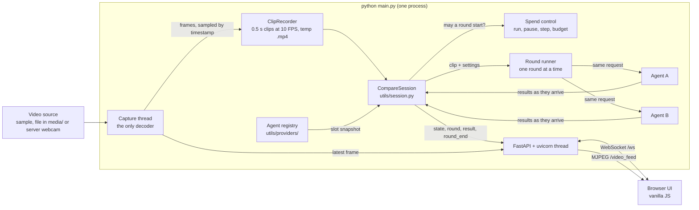
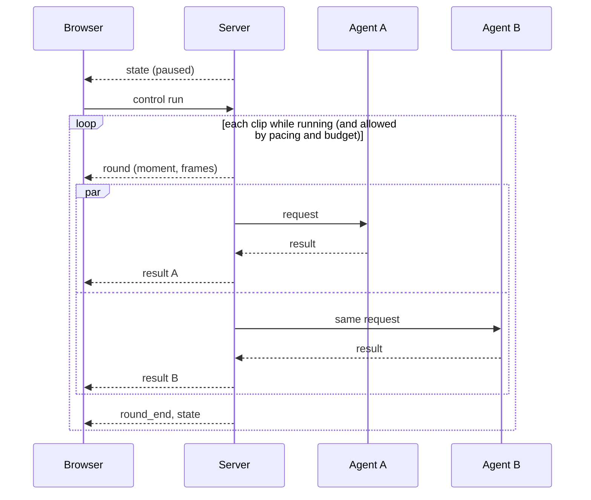

# Video Prompt Sandbox

**Play a video, ask two vision models the same question about the same moment, and compare their answers, latency,
tokens and estimated cost side by side, live in the browser. No GPU needed.**

[](https://github.com/LordLokator/VLMPromptEngineeringSandbox/actions/workflows/ci.yml)
[](LICENSE)

## Quick start (no GPU, no key)

Needs Python 3.11 or 3.12 and `git`. Inside a virtual environment:

```bash
git clone https://github.com/LordLokator/VLMPromptEngineeringSandbox && cd VLMPromptEngineeringSandbox
pip install .
python main.py     # then open http://localhost:8000/ and press Run
```

This starts two built-in **demo agents**. They run no model: they answer with facts measured on the frames they
received (size, brightness, where and when the picture changes), so they ignore the prompt. They show the layout and
the flow, not model quality.

To compare real models, set a key or URL (in the shell, or in a git-ignored `.env`: `cp .env.example .env`) and pick
the provider and model in each agent's card, or at startup:

```bash
OPENAI_API_KEY=sk-... ANTHROPIC_API_KEY=sk-ant-... \
VLM_AGENT_A=openai:gpt-5.4-mini VLM_AGENT_B=anthropic:claude-haiku-5-5 python main.py
```

The model names are examples: the card lists what your provider offers, and free text always works. Both slots may
use the same provider and key, for example `anthropic:claude-haiku-5-5` against `anthropic:claude-sonnet-5-5`; only
`hf` is limited to one slot.

An Anthropic key comes from the [Claude Console](https://platform.claude.com/docs/en/get-api-key). API calls are
[paid with Console credits](https://support.claude.com/en/articles/8977456-how-do-i-pay-for-my-claude-api-usage),
separate from a Claude.ai subscription; Max, Ultra and Team plans
[include monthly API credits](https://platform.claude.com/docs/en/about-claude/api-credits-for-subscribers).

## Providers

| Provider | `VLM_AGENT_A` / `_B` | Needs | Status |
|---|---|---|---|
| Demo (no model) | `demo`, `demo:frame-motion` | nothing | runs: CI starts the app with it and gets an answer over `/ws` |
| OpenAI | `openai:<model>` | `OPENAI_API_KEY` | **unit-tested only** |
| Anthropic | `anthropic:<model>` | `ANTHROPIC_API_KEY` | **unit-tested only** |
| Ollama | `ollama:<model>` | a running Ollama (`OLLAMA_BASE_URL`, default `http://localhost:11434`) | **unit-tested only** |
| Any OpenAI-compatible server (OpenRouter, vLLM, ...) | `compat:<model>` | `VLM_COMPAT_BASE_URL`, optional `VLM_COMPAT_API_KEY` | **unit-tested only** |
| Local VideoLLaMA3-7B | `hf` | a CUDA GPU, the `gpu` extra, `VLM_ENABLE_HF=1` | **not run on a GPU** since the overhaul ([details](#local-model-cuda-gpu)) |

"Unit-tested only" means the adapter is tested with fake SDK clients and was checked against a local stub server, but
no real provider has answered a call from this code yet. You can try one provider with one call before starting the
app: see [Checking a provider](#checking-a-provider).

> **Cost and privacy.** Every agent except `demo`, `hf` and Ollama on this machine (not its cloud models) is treated as **remote and paid**.
> A remote agent receives the frames of your video and may charge for every call. The app starts paused and calls
> nothing until you press **Run** or **Step**; with a remote agent it waits at least 5 s between rounds and stops after
> 50 rounds or $0.50 of estimated cost, whichever comes first. Costs are estimates from a list-price snapshot, not a
> bill, and "n/a" when unknown. Set a spending limit at your provider as well. Keys are read only from the environment;
> the page can never set a key or a URL, and key values are [redacted](#configuration) in the log.

## Features

- **Two agents side by side:** agent A left, agent B right, the video in the middle. Both get the same frames of the
  same 0.5 s moment; the page shows those frames, the moment's time range and which round each answer is about.
- **Agents chosen in the page:** provider and model per side, from the provider's model list where it offers one (free
  text always works). An unavailable provider says why, for example a missing key.
- **Per answer:** latency, input and output tokens, estimated cost ("n/a" when unknown, "no API fee" for the local model and Ollama on this machine),
  the model and the parameters actually sent; session totals per agent. "Faster" and "cheaper" are marked only when
  both answered the same round with known values; there is no quality verdict. A **Metrics** switch hides the figures.
- **Spend control:** Run, Pause and Step (one round). The budget is refilled only by "Reset budget". An authentication
  error, three failures in a row from one agent and the last browser tab closing also pause it.
- **Live settings:** prompt, temperature (0.01 to 1.0) and resample FPS (1 to 10) apply from the next round; no restart.
  Nine built-in street-scene prompt presets, and your own saved from the page. Prompt changes are logged with a time.
- **Video sources:** two bundled street videos, your own `.mp4` / `.webm` files in the `media/` folder, or the server's
  webcam, switched in the page (see [Video sources](#video-sources)).
- **Failure behaviour:** one agent's error or timeout shows on its card and never affects the other; the browser
  reconnects with backoff (1 s to 10 s).
- **Optional OpenTelemetry** traces and metrics, off by default.

## How it works



- **One decoder per source.** A capture thread plays the source at its own speed; the browser preview (scaled to at
  most 720 px high) and the clips come from it. Clips sample it on a 10 FPS grid by frame timestamp and never span two
  sources or the point where a file starts over. If timestamps stall or go backwards, the frame rate is used instead
  (30 FPS if the reported one is implausible).
- **Each clip knows its moment:** source, start and end time and loop number (webcam: wall-clock time). An answer for a
  clip from before the last source switch is still shown and counted (the call was made), marked "previous source".
- **One round at a time, in lockstep, no queue.** Both agents run in parallel; the next round starts when both have
  answered, failed or timed out, so the slower agent sets the pace and answers do not fall behind the video. A call
  stuck in an SDK is abandoned after 130 s (each provider's own timeout is shorter); a late answer is not shown but
  still counts toward the budget.
- **One contract for every agent** (`utils/providers/`): `generate(request) -> Result`. Remote agents get frames, the
  input form these APIs have in common: the ones the local model's loader picks at the resample FPS, scaled to at most
  768 px on the long edge at JPEG quality 80, the same bytes for both agents. The local model gets the clip file.
- **Thin adapters on the official `openai` and `anthropic` SDKs**, no router library: the app needs a small part of
  what one offers, and two SDKs add far fewer dependencies. Anthropic uses its native Messages API.
- **All GPU code sits in `utils/vlm_wrapper.py`**, with lazy imports, so everything else is testable without torch.
- **Clips are temporary:** deleted once both agents are done, or at once if dropped or skipped while paused.

## Configuration

All settings are environment variables, all optional. A git-ignored `.env` in the repository root is read at startup
(and by the provider check); `.env.example` lists every setting commented out, ready to copy. A variable set in the
real environment wins, even when empty. An empty variable counts as unset.

**Fail fast:** every setting is checked before the server starts. An invalid one stops the app with exit code 2 and
one line per problem, naming the variable and never its value. That includes a `.env` line that cannot be parsed or
has no `=`, an unknown `VLM_*` name (a typo), an on/off flag that is not `1` or `0`, a bad port, host, URL,
`VLM_ATTN_IMPL` or OTel exporter, `OTEL_ENABLED=1` without the `otel` extra, and an agent whose key or URL is missing
or that cannot be built. Not checked at startup: whether a key is accepted or a model id exists (that needs a paid
call); the first round shows such errors. One exception to the format: an invalid `VLM_ALLOWED_HOSTS` entry stops the
app with exit code 1 and names that entry. If the local `hf` model fails to load, that is not a configuration error:
its slot starts with the demo agent instead.

**Agents and providers**

| Variable | Default | Meaning |
|---|---|---|
| `VLM_AGENT_A`, `VLM_AGENT_B` | `demo`, `demo:frame-motion` | The agents at startup, `provider` or `provider:model`, split at the first colon (so `ollama:llava:13b` works). A missing key or URL, or an unknown provider, stops the app at startup with a message. Both can be changed in the page. |
| `OPENAI_API_KEY` | unset | Key for `openai`. Sent only to `https://api.openai.com/v1`. |
| `ANTHROPIC_API_KEY` | unset | Key for `anthropic`. Sent only to `https://api.anthropic.com`. |
| `OLLAMA_BASE_URL` | `http://localhost:11434` | Ollama server for `ollama` (its OpenAI-compatible `/v1` API; models listed with `/api/tags` and `/api/show`). |
| `VLM_COMPAT_BASE_URL`, `VLM_COMPAT_API_KEY` | unset | Any OpenAI-compatible server for `compat`. Without a key the placeholder `EMPTY` is sent, never the OpenAI key. |
| `VLM_ENABLE_HF` | unset | `1` makes `hf` (local VideoLLaMA3) available: it downloads the model at a pinned revision and loads it at startup on a CUDA GPU. It fills one slot at most; if loading fails, that slot starts with its demo agent and the page says why. |
| `VLM_ATTN_IMPL` | `flash_attention_2` | Attention implementation for `hf`. No value has run on a GPU with the current pins; `sdpa` and `eager` ran only in the [CPU checks](#ml-stack-what-was-checked). |
| `VLM_BACKEND` | removed | Replaced by `VLM_AGENT_A` / `VLM_AGENT_B`; if set, the app stops at startup and names them. |

The SDKs would also read `OPENAI_BASE_URL`, `OPENAI_ORG_ID`, `OPENAI_PROJECT_ID`, `OPENAI_CUSTOM_HEADERS`,
`ANTHROPIC_BASE_URL`, `ANTHROPIC_CUSTOM_HEADERS` and others by themselves; the app clears them, so nothing meant for one
provider reaches another server, and it switches off the Anthropic SDK's own OpenTelemetry spans. Provider clients do
not follow redirects and do not retry; a call times out after 30 s (120 s for Ollama, where a cold model load can take
a while). Anthropic gets no `temperature`: the API version the pinned SDK sends (2026-10-21) has no sampling parameters
in its Messages API. If another model rejects `temperature`, the call is repeated once without it, and that model is
not sent one again during the run.

**Server**

| Variable | Default | Meaning |
|---|---|---|
| `VLM_HOST` | `127.0.0.1` | Bind address. A non-loopback value requires `VLM_ALLOWED_HOSTS`, logs a warning (there is no authentication) and disables the API docs. |
| `VLM_ALLOWED_HOSTS` | empty | Comma-separated host names or IP addresses, without ports, that browsers use to reach the app, for example `192.168.1.20,mybox.local`. `localhost`, `127.0.0.1` and `[::1]` are always allowed. `*.example.com` matches subdomains; a bare `*` is refused. It guards against DNS rebinding and is not authentication. |
| `VLM_PORT` | `8000` | Port. |
| `VLM_ALLOW_REMOTE_PAID` | unset | With a non-loopback `VLM_HOST`, remote (paid) agents are off unless this is `1`. |
| `OTEL_ENABLED`, `OTEL_*` | off | See [Observability](#observability-opentelemetry). |

Files the app writes: user presets in `presets/user_presets.json`, prompt history in `prompting/history.json`
(both git-ignored).

**Logs** go to stderr, Python's standard `logging` (uvicorn included) and uncaught errors on the same path. Tracebacks
do not print local variable values. For agent and capture failures the log keeps the kind of failure, the exception
class, any HTTP status and the stack, not the exception message; other errors, such as a model that fails to load, keep
their message. The values of `OPENAI_API_KEY`, `ANTHROPIC_API_KEY`, `VLM_COMPAT_API_KEY`, `HF_TOKEN` and
`HUGGING_FACE_HUB_TOKEN`, if set and at least 8 characters long, are replaced with `[redacted]` in log text. Output that
bypasses Python logging (native libraries, the OpenTelemetry console exporter) is not filtered. An unhandled error in a
route is answered with a plain HTTP 500 (WebSocket: close code 1011), so its text never reaches an OpenTelemetry span.

### Video sources

Copy your own `.mp4` or `.webm` files into the `media/` folder next to `main.py` (created at start, git-ignored), then
press **Rescan media/** or reload the page. Files loop. The page sends only an id the server listed (`sample:1`,
`media:3`, `webcam`), never a path, so it cannot open any other file. A file is refused, with the reason next to the
picker, if it cannot be decoded or is larger than 1920x1080 or 1 GB; a source that fails stays failed until a source is
selected again, and the preview shows an error image. Sending webcam frames to a remote agent asks for confirmation
first.

### Checking a provider

Each API adapter can be tried with one call, without the app:

```bash
python -m utils.providers.check openai --list                # the models the provider offers
python -m utils.providers.check openai <model>               # one call on one 0.5 s clip of the sample video
python -m utils.providers.check ollama <model> --fps 3       # 2 of the 5 frames, as the app would send them
```

Providers: `openai`, `anthropic`, `ollama`, `compat` and `demo`. One call sends up to 5 frames and asks for at most 1024
output tokens; a paid provider charges for it. It prints the answer, finish reason, token counts, latency, estimated
cost and the parameters sent, never the key.

### Cost estimates

Prices come from a snapshot in [`utils/prices.json`](utils/prices.json): list prices of OpenAI and Anthropic vision
models, standard tier, taken on 2026-11-28 from [LiteLLM's price map](https://github.com/BerriAI/litellm) (MIT licence,
notice in the file). Only exact model ids match. An unknown model, cache tokens without a rate, or input above a
long-context limit give "n/a", never $0. Ollama on this machine has no API fee; `compat` and remote or cloud Ollama
models are unpriced, unless the server reports the cost itself (as OpenRouter does in `usage.cost`), which then wins.

## Protocol

### WebSocket `/ws` (JSON text frames, each an object with a `type`)

| Client to server | Fields | Effect |
|---|---|---|
| `update` | `text`?, `temperature`?, `resample_fps`? | Settings for the next round (clamped to range); a non-empty `text` sets the prompt. |
| `control` | `action`: `run` \| `pause` \| `step` \| `reset_budget` | Spend control; a refusal comes back as `error`. |
| `set_agent` | `slot`: `A` \| `B`, `provider`, `model`?, `enabled`?, `confirm`? | Changes an agent from the next round. |
| `list_models` | `provider`, `refresh`? | Replies with `models`. |
| `set_source` | `source_key` (one listed in `state.sources`), `confirm`? | Switches the source for all clients. A `media:<n>` key names the same file for the life of the server; a file deleted since is refused. |
| `list_sources` | none | Rescans `media/`. If the list changed, all clients get `state`, otherwise only the sender. |

Sending webcam frames to a remote agent needs `confirm: true`; without it the reply is an `error` with
`confirm: "webcam_remote"`, and the page asks.

| Server to client | Sent to | Content |
|---|---|---|
| `state` | the new client, then all on any change | Providers with availability and reason, both slots (provider, model, enabled, remote, where frames go), run state and budget, settings, source and its error, selectable sources, price list date. |
| `round` | all | Round and clip ids, source, start and end time, loop, prompt, frame times and thumbnails (JPEG data URLs). |
| `result` | all | Round and clip ids, slot, `status` (`ok`, `error`, `timeout`, `skipped`), `stale`, text, `finish_reason`, `error{kind, message}`, metrics (latency, tokens, cost and its source, model, parameters sent). |
| `round_end` | all | Round id and each slot's status. |
| `models` | sender | A provider's model list, or why listing failed. |
| `system`, `error` | sender (capture errors: all) | `text`. Errors name a kind of failure, the exception class and any HTTP status, never the exception message. |



Limits: `text` is capped at 2000 characters. A frame over 64 KiB closes the connection (code 1009). Browser connections
from another origin are rejected (code 1008). HTTP requests and WebSocket connections whose `Host` header is not
[allowed](#configuration) are refused (HTTP 400).

### HTTP

| Route | Purpose |
|---|---|
| `GET /` | Web UI (static assets under `/src`) |
| `GET /favicon.ico` | Page icon |
| `GET /video_feed` | MJPEG preview of the active source, at most 720 px high |
| `GET /preset_buttons` | Built-in and user presets, as a list of `{"label", "text"}` |
| `POST /save_preset` | JSON `{"label", "text"}`; the label is trimmed to 25 characters. Returns `{"status": "ok", "label"}`, or an error with status 400 or 415. |

FastAPI's `/docs` and `/redoc` are available only when bound to a loopback address.

## Local model (CUDA GPU)

Optional: [`DAMO-NLP-SG/VideoLLaMA3-7B`](https://huggingface.co/DAMO-NLP-SG/VideoLLaMA3-7B) on HuggingFace
Transformers, bfloat16, FlashAttention2, on `cuda:0`; no quantization and no CPU fallback. It needs a CUDA GPU with
FlashAttention2 support (Ampere or newer), an NVIDIA driver and toolkit (`nvcc`) for **CUDA 13** (the `torch==2.13.0`
Linux wheel on PyPI is a CUDA 13 build, and flash-attn is compiled against it), `git` and Python 3.11. The tested OS is
Ubuntu, with the university version.

```bash
git clone https://github.com/LordLokator/VLMPromptEngineeringSandbox && cd VLMPromptEngineeringSandbox
bash setup.sh                 # creates .venv, installs the "gpu" extra and flash-attn
source .venv/bin/activate
VLM_AGENT_A=hf VLM_ENABLE_HF=1 python main.py
```

The model repository is downloaded from Hugging Face at a pinned revision and loaded from that local snapshot.

**What has run:** the university version ran on **Ubuntu + RTX 4090** with `torch==2.2.0`, `transformers==4.46.3` and
`numpy==1.24.4`. The author measured there:

| Metric | Value |
|---|---|
| VRAM | about 24 GB required |
| Latency at 10 FPS resampling | about 200 ms |
| Latency at 30 to 40 FPS (similar setup; above this UI's 10 FPS limit) | about 400 ms |

**What has not:** neither the current code (the overhauled model wrapper and setup script, the `decord` video path)
nor the current pins (`torch==2.13.0`, `transformers==4.57.6`, `numpy==2.4.6`, a coupled set because of the model's
remote code) has been run on a GPU. Loading the real weights and generating real answers are untested, and the figures
above were not re-measured.

- **flash-attn has not been built for this repository.** `setup.sh` installs it last, from a pinned upstream commit,
  because the latest PyPI release (2.8.3.post2, checked 2026-11-26) compiles as C++17 while torch 2.13 headers use C++20.
  The build can need a lot of memory (an [upstream report](https://github.com/Dao-AILab/flash-attention/issues/2995)
  saw more than 10 GB for one compile process). If only that step fails, `VLM_ATTN_IMPL=sdpa python main.py` is worth
  trying (also not run on a GPU).
- **Headless OpenCV:** every install uses `opencv-python-headless`. The model's remote code at the pinned revision
  calls only `cv2.imread` and `cv2.cvtColor`, which it has; checked by reading the code, not by importing them together.

### ML stack: what was checked

In Linux Python 3.11 containers **without a GPU**, with CPU torch wheels, the model's code, config and tokenizer at the
pinned revision and **no weights** (2026-11-26, the `decord` checks 2026-11-27):

- The pinned set installs and passes `pip check`; with PyPI's CUDA wheels it resolves (not installed) on 3.11 and 3.12.
- The remote code's classes import and the config and processor load, with a short alias in
  [`utils/vlm_wrapper.py`](utils/vlm_wrapper.py) for a name that transformers moved.
- Built on the `meta` device, the model's 779 tensor names and total `bfloat16` size match the checkpoint index.
- A **tiny, randomly initialised** copy of the architecture loaded through the app's own `VLM` class and generated
  (meaningless) tokens with `sdpa` and `eager`, at 10, 2 and 5 FPS.
- The `decord` loader path ran for three recorder clips at each FPS from 1 to 10 without `ffmpeg` installed; its frame
  counts matched the rate the app reports, and at 10 FPS it returned the same frames as the older `ffmpeg` path.

Not checked: anything on a GPU (CUDA wheels, `device_map` to a GPU, the flash-attn build and `flash_attention_2`), the
real weights, answer quality, VRAM and latency.

## Limitations

- **A proof of concept for one user on localhost:** no authentication, and settings and source are shared by all
  connected clients. Not a production service.
- **API agents are unit-tested only** and the local model has not run on a GPU since the overhaul (see
  [Providers](#providers)).
- **Answers lag the video:** an answer is about a half-second moment that has passed on screen by the time it arrives;
  the card says which moment. Each clip is answered on its own (no memory), and output arrives as a whole message.
- **Resample FPS is coarse:** a 0.5 s clip has only 5 frames. Slider values 1 and 2 give 1 frame (shown as 2 fps), 3 to
  5 give 2 frames (4 fps), and 6 to 10 all 5 (10 fps).
- **Capture is tested with fake and generated video only:** not with a real webcam, not with a file recorded by a real
  browser, and not by watching the preview in a browser. The tests cover corrupt, empty, truncated and oversized files
  and a WebM shaped like a browser recording. AV1 files depend on the decoders in the installed OpenCV build; untried.
- **Accepted advisories:** `transformers==4.57.6`, the newest 4.x release, has known advisories. Six were reviewed on
  2026-11-27 and are ignored in [`osv-scanner.toml`](osv-scanner.toml) until 2027-02-28, each with its reason (read from
  code and configuration, no exploit attempted). The reasons depend on the pinned model revision and on loading it from
  a local snapshot; for GHSA-x9r9-c232-4q39, model loading does call the affected function, on a snapshot that has no
  `custom_generate/` directory.
- **Remote code:** the model loads with `trust_remote_code=True`. The app downloads one fixed repository revision and
  gives the loaders only that local directory; with `transformers==4.57.6`, passing the repository name and
  `revision=` was not enough (`AutoProcessor` looked up the files that choose which code to run on the `main` branch).

## Observability (OpenTelemetry)

Off by default; nothing from `opentelemetry` is imported unless enabled.

```bash
pip install ".[otel]"

# spans and metrics printed to the console
OTEL_ENABLED=1 python main.py

# send to an OTLP/gRPC collector
OTEL_ENABLED=1 OTEL_TRACES_EXPORTER=otlp OTEL_METRICS_EXPORTER=otlp \
  OTEL_EXPORTER_OTLP_ENDPOINT=http://localhost:4317 python main.py
```

| Signal | Name | Notes |
|---|---|---|
| Span | `vlm.inference` | One per agent call: agent (`provider:model`), FPS, max frames, temperature; on failure, error status and exception type (no message or stack trace). |
| Histogram | `vlm.inference.duration` | Seconds, by agent and outcome. |
| Counter | `vlm.inference.errors` | By agent. |
| Counter | `vlm.clips.dropped` | Clips skipped while a round was running. |
| Counter | `ws.messages` | Client messages, by `type` (unknown ones as `other`). |
| Up/down counter | `ws.connections` | Active WebSocket connections. |
| FastAPI instrumentation | HTTP spans and metrics | `/video_feed` and per-message WebSocket spans are excluded. |

The app's own spans and metrics never include prompt text, model output, clip paths or frames. `OTEL_SERVICE_NAME` and
`OTEL_METRIC_EXPORT_INTERVAL` are honoured. Besides the in-memory exporter tests, every signal in the table was checked
once against `grafana/otel-lgtm:0.41.1` on 2026-11-26 with a mocked backend, over OTLP/gRPC.

## Development

No GPU needed: the model is mocked in tests, and agents are faked (`tests/fake_agents.py`). One test starts the real
`python main.py` with the demo agents on a free loopback port and waits for an answer over `/ws`. Tests under
`tests/manual/` need a real device or file and are skipped unless `VLM_MANUAL_TESTS=1`; their docstring says what they
use.

```bash
pip install ".[dev]"
python -m compileall -q .
ruff check .
pytest -q
```

CI runs lint and a compile check, tests on Python 3.11 and 3.12, a plain `pip install .` in a new venv that imports the
app with torch blocked, and a dependency-resolution check of the `gpu` and `dev` extras on both versions (each must
resolve to exactly one OpenCV distribution). All dependencies are declared in [`pyproject.toml`](pyproject.toml), whose
comments describe each group; no requirements or lock file is committed. The security workflow's osv-scanner job
resolves the `gpu` extra (and the base dependencies) for Linux and Python 3.11 into a temporary list and fails on any
advisory not in `osv-scanner.toml`; it is not a required check, and transitive versions can differ between runs.
Dependabot alerts are based on the pins in `pyproject.toml` on the default branch.

```
main.py, web_engine.py   wiring and shutdown; HTTP and /ws
utils/                   agents (providers/), rounds and spend control, VLM wrapper, telemetry, presets, file helpers
video_handling/          capture, clip recording, streaming
prompting/               prompt state, runtime settings, history
src/                     frontend
presets/, static_video/  built-in prompts, sample videos
media/                   your own videos (created at start, git-ignored)
tests/                   GPU-free test suite
```

| Area | Used |
|---|---|
| Models | OpenAI and Anthropic SDKs, Ollama; VideoLLaMA3-7B on HuggingFace Transformers, PyTorch, FlashAttention2 |
| Backend | Python, FastAPI, uvicorn (HTTP and WebSocket), Loguru |
| Video | OpenCV for capture and encoding; decord decodes clips for the local model |
| Frontend | Vanilla JavaScript, Bootstrap CSS (vendored, so no CDN) |
| Observability | OpenTelemetry SDK, OTLP exporter, FastAPI instrumentation (optional) |
| Quality | pytest, Ruff, GitHub Actions, gitleaks, osv-scanner, dependency review, Dependabot |

## Background

Built in May 2025 for the university course Prompt Engineering (VITMAV82) as a controlled sandbox, not another chat
interface: to explore prompt design for multimodal models, temporal video chunking and latency vs. FPS trade-offs on a
local Video-LLM. In November 2026 it was overhauled with Claude Code: audit, bug fixes (for example a temperature
slider that had no effect), hardening, the test suite, CI, OpenTelemetry, and the move from one local model to
comparing two models from any provider without a GPU.

## License

MIT, see [LICENSE](LICENSE). The vendored Bootstrap CSS has its [own license file](src/vendor/bootstrap.LICENSE). Models
are provided separately and are subject to their own terms.
